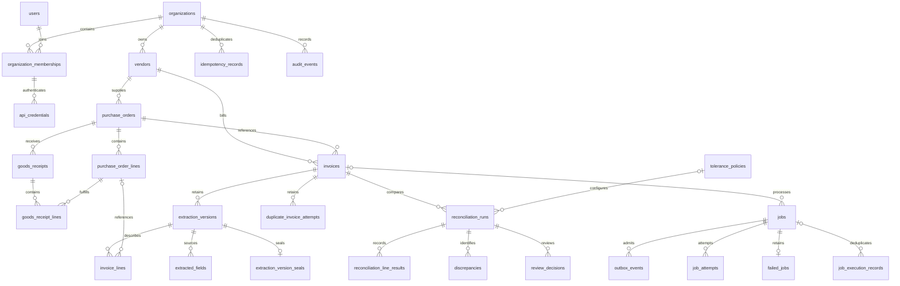

# Financial persistence

Milestone 03 extends the milestone 02 SQLAlchemy/PostgreSQL schema. It preserves the HTTP interfaces, generated clients, existing records and synthetic dashboard. PostgreSQL is authoritative for the full stack; SQLite is a supported local development and test mode.

## Entity relationships

Every domain relationship below carries `organization_id` in addition to its parent identifier. Global user subjects have organization memberships; API credentials can bind to a membership and its role.

`invoices.validated_extraction_id` selects a version belonging to that invoice and organization. Run evidence points to an extraction version and an optional versioned tolerance policy. Results and discrepancies carry the invoice as well as the run, preventing a result from being attached to another invoice's run. Receipt lines must reference lines within the receipt's own PO. Invoice lines optionally reference that invoice's PO and its lines. Currency and vendor composite foreign keys keep invoices consistent with their PO.

The original JSON PO/receipt lines and scalar dashboard projections remain for compatibility. New REST writes create both JSON and normalized line rows in one transaction. Backfill normalizes existing JSON only when source line detail exists; old summary-only records remain explicitly `financial_state=legacy`. A migration never invents missing invoice numbers, extraction evidence or monetary detail, and never presents a legacy amount as validated.

## Table changes

| Added table                   | Purpose                                                            |
| ----------------------------- | ------------------------------------------------------------------ |
| `users`                       | Local identity subjects and activation state                       |
| `organization_memberships`    | Organization-specific role and activation                          |
| `vendors`                     | Tenant-scoped supplier identity and optional integration reference |
| `tolerance_policies`          | Immutable currency/policy versions                                 |
| `purchase_order_lines`        | Exact ordered quantities and prices                                |
| `goods_receipt_lines`         | Received quantities linked to the correct PO line                  |
| `extraction_versions`         | Immutable document digest, payload and validation provenance       |
| `extracted_fields`            | Versioned source values, pages and optional confidence             |
| `extraction_version_seals`    | Retained publication seals, including superseded versions          |
| `invoice_lines`               | Versioned exact quantities, discounts, tax and totals              |
| `duplicate_invoice_attempts`  | Rejected supplier-number attempts without duplicate invoices       |
| `reconciliation_line_results` | Immutable per-run line outcomes and differences                    |
| `job_attempts`                | Bounded execution history and recovery context                     |
| `failed_jobs`                 | Retained terminal failure evidence and next action                 |

Existing `api_credentials` and `review_decisions` gain linked user references. `purchase_orders`, `goods_receipts` and `invoices` gain normalized aggregate/financial state. `reconciliation_runs` links extraction and tolerance versions. `jobs` and `outbox_events` gain recovery fields; `job_execution_records` gains tenant-scoped keys and an optional job reference. Composite constraints strengthen their relationships with `audit_events`, `discrepancies` and `webhook_receipts`. Existing `organizations` and `idempotency_records` remain in place.

## Exact monetary rules

Amounts use nonnegative `BIGINT` minor units, bounded by 9,007,199,254,740,991 so generated JavaScript clients remain exact. Signed discrepancy deltas use the corresponding signed range. Currency is explicit and constrained to the supported ISO 4217 subset: USD/EUR/PHP exponent 2, JPY exponent 0, KWD exponent 3. Unknown codes fail closed. There is no FX conversion.

Quantities are positive Decimal values, at most `999999999.999999`, with up to six fractional places. Tax rates are Decimal fractions from 0 to 1 with up to six places. Python rejects floats; PostgreSQL uses `NUMERIC(15,6)`. SQLite stores canonical decimal text through `ExactDecimal`, avoiding SQLite's floating numeric affinity. Its deterministic Decimal SQL functions mirror PostgreSQL's exact NUMERIC functions for constraint checks.

For each line:

1. Gross minor units = quantity × integer unit price, rounded once to an integer with `ROUND_HALF_UP`.
2. An explicit integer discount, between zero and gross, reduces the tax basis.
3. Exclusive tax = round((gross − discount) × rate); total = gross − discount + tax.
4. Inclusive tax = round((gross − discount) × rate / (1 + rate)); total = gross − discount. The tax is already contained in that total.

All rounding occurs at the line, using a 50-digit Decimal working context. Invoice subtotal, discount, tax and total must each equal the exact sum of their line values; no hidden header residual is accepted. PostgreSQL checks line arithmetic and checks the full aggregate when an invoice is promoted to validated. Published headers cannot drift from the selected immutable lines. Normalized POs similarly check their gross line sum and header tax mode on sealing. Existing PO contracts accept explicit header tax/discount; they do not assert a tax rate per PO line.

`MonetaryTolerance` and immutable `tolerance_policies` configure an absolute integer allowance per organization/currency/version. A difference is accepted only when `abs(expected − observed) <= amount_minor` in the same currency. Tolerance never relaxes invoice internal arithmetic. The seed provides exact (0) and rounding (1) policies; no full matching engine is implemented in this milestone. Tax examples are arithmetic fixtures, not jurisdictional tax advice or rules.

## Duplicates, evidence and transactions

Supplier numbers retain their original text and a normalized key: remove ASCII spaces and uppercase supported ASCII characters, preserving punctuation. Uniqueness is `(organization_id, vendor_id, normalized_invoice_number)`. The same number can occur for another vendor or tenant. New validated invoices require a vendor and nonempty number; incomplete legacy/upload records may retain null fields until extraction provides them. File hashes are provenance, not a global duplicate key.

A duplicate attempt is retained with its existing invoice, supplier, document digest, reason and audit event. A corrected extraction creates a new immutable extraction version under the same invoice; do not bypass uniqueness by creating another authoritative invoice. A supplier reissue with a new number is a new invoice. Credit notes and adjustments require a later explicit model; negative invoice amounts are currently unsupported.

Extraction versions, extracted fields, invoice/receipt lines, reconciliation line results, review decisions, tolerance versions, duplicate attempts, failed-job evidence and completed execution keys reject updates/deletes. PostgreSQL also blocks truncation of protected evidence tables. PO lines become immutable when normalized. Published versions reject appended fields/lines. Immutable `extraction_version_seals` retain that protection after another version is selected. Database publication triggers create seals atomically, including for direct SQL publication; revision 0005 conservatively backfills seals for all existing versions declared validated. Receipt aggregates reject late appended lines. Corrections require new evidence or an audited forward migration. Audit events remain append-only, including the original milestone 01/02 history.

Aggregate writes use a single SQLAlchemy transaction for records, normalized lines, idempotency responses, outbox envelopes and audit events. Savepoints allow retaining a rejected duplicate attempt without retaining a duplicate invoice. Review requests retain the existing expected-version API, row locking on PostgreSQL and the unique invoice/version decision constraint; SQLAlchemy version checks provide a second optimistic concurrency guard. A conflict returns the existing 409 error and cannot commit a second review or audit effect.

Tenant-composite foreign keys enforce references even for direct SQL writes. Tenant-led list indexes, unique supplier keys and recovery indexes support scoped access. API authorization still derives organization from a server-side credential lookup and scopes every query; these constraints do not implement PostgreSQL row-level security or restrict a privileged database owner from reading other tenants. Deactivated linked users/memberships fail authentication. Existing unlinked local credentials retain compatibility; configured credentials are linked by migration/seed. Production identity and database-role hardening remain future work.

## Durable processing boundary

`jobs` retains `pending_dispatch` and adds a maximum of five total attempts, next-attempt time, lease owner/expiry and trace identifier. `outbox_events` gains an explicit tenant key, attempt count, availability and dispatch lease fields. `job_attempts` records numbered execution attempts, worker, trace, start/finish, retry time and error code; a partial unique index allows one running attempt per job. Attempt numbers cannot exceed the job's limit. Finished attempts cannot be edited or deleted.

`failed_jobs` retains terminal code, retryability, next action and trace. `job_execution_records` now has tenant-scoped execution-key uniqueness and an optional job reference, retaining the original bootstrap-probe records. `idempotency_records` continues to guard HTTP admission; it serves a different boundary from worker effect keys.

Milestone 04 implements confirmed outbox publication, lease recovery, bounded processing retries, terminal records and idempotent digital-text effects on these structures. Revision `0006_processing_stage` adds a non-financial job stage projection without replacing any financial tables or migration history. Digital-text versions remain untrusted but are sealed against later edits. The publisher explicitly sends retained terminal events to RabbitMQ; the original independent probe remains available. See the [processing runbook](../operations/processing.md) for transitions, limits and recovery procedures.

See [migration and fixture operations](../operations/database.md) and [verification evidence](../verification/milestone-03.md).
