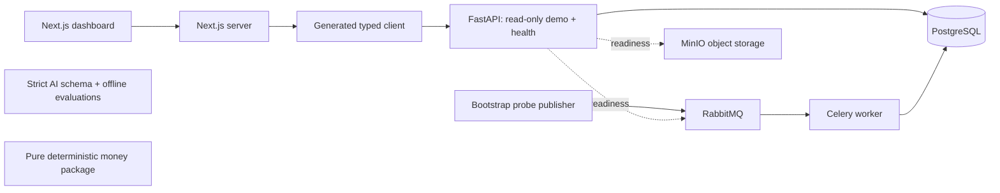

# Milestone 01 architecture

The diagram represents implemented connections. MinIO has health verification only; document storage/extraction is not yet wired. The AI and money packages are isolated foundations, not a full extraction or matching pipeline. Lite mode replaces PostgreSQL with SQLite and explicitly disables broker/object-store readiness requirements.

The frontend server fetches `/v1/demo/snapshot` using `openapi-fetch` and generated schema types. Client components receive only synthetic records. `API_BASE_URL` stays on the server; there are no public secret environment variables or browser-to-infrastructure connections. Errors render an unavailable screen with retry, without silently falling back to fixtures.

SQLAlchemy owns four initial tables: `purchase_orders`, `invoices`, `audit_events`, and `job_execution_records`. Migration `0001_foundation` creates them explicitly. Audit updates/deletes are rejected both in the ORM and by database triggers; PostgreSQL also rejects truncation. Seed records and their creation events commit in one transaction. The initial downgrade intentionally refuses to destroy audit history.

The worker probe inserts a unique business key and its audit event in a transaction. Concurrent duplicate inserts are arbitrated by the database primary key. A repeat delivery returns the stored result. Celery uses JSON only, late acknowledgments, lost-worker requeueing, bounded transient database retries (five total attempts), and prefetch=1. Compose uses concurrency=1 for a deterministic smoke-test barrier; the host worker target defaults to 4. This probe demonstrates the pattern; it does not implement the later extraction pipeline, failure store, DLX or outbox.

Money is represented as bounded integer minor units and an explicit supported currency. Pure Python utilities convert Decimal values with currency-specific exponents and half-up rounding. The frontend formats integer and fraction parts separately so large safe integers retain their exact cents. It performs no authoritative matching or currency conversion.

The single synthetic workspace is deliberately unauthenticated and read only. Future business mutations require server-derived tenant context, authorization, durable idempotency, optimistic concurrency, audit events and reviewed contracts. Full PO/receipt/invoice line schemas, OCR/LLM providers, uploads, human reviews, GraphQL, telemetry and deployment pipelines follow the milestone order in `CODEX.md`.
