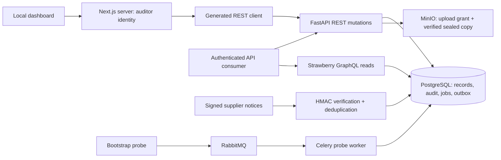

# Milestone 02 architecture

The diagram shows implemented paths. REST owns writes and GraphQL owns dashboard reads. Both derive organization/actor/role from a server-side credential digest lookup. HMAC supplier identities are separately configured and cannot supply their own tenant context. All collections use bounded, signed keyset pagination. The canonical OpenAPI and hand-authored GraphQL SDL are checked against actual served schemas; REST and GraphQL clients are generated from those contracts.

The dashboard remains a local read-only synthetic workspace. Its Next.js server calls `/v1/demo/snapshot` using the generated REST client and an auditor key. `API_BASE_URL` and `RECONCILE_WEB_API_TOKEN` remain on the server; browser components receive synthetic records, never credentials. The local dashboard has no end-user login. Errors render a retryable unavailable screen without falling back to fixtures. Generated GraphQL documents and a typed transport are available for consumers; they are not yet the dashboard's data source.

Migration `0002_contracts` extends the preserved foundation with organizations, credential digests, versioned upload metadata, PO lines, goods receipts, reconciliation run/result examples, discrepancies, review decisions, jobs, outbox envelopes, idempotency records and webhook receipts. Existing seed records and audit history are retained. SQLAlchemy writes state, replay result and relevant audit events atomically. Database audit triggers reject updates/deletes (and PostgreSQL truncation); the ORM also protects audit updates. Both migrations refuse destructive downgrades.

Every bearer mutation claims an organization-wide idempotency key transactionally before its business effects. The fingerprint binds actor, route and normalized validated body. Matching retries return the committed response; altered requests conflict. Existing record mutations check an expected version and lock the row in PostgreSQL. Upload completion verifies bounded size, MIME, signature and hash, then seals a separate object key so the original presigned URL cannot mutate worker input.

New asynchronous jobs, outbox envelopes and audit events commit together, with a per-organization admission bound. **There is no business outbox publisher or extraction/reconciliation worker yet.** New jobs remain `pending_dispatch`; synthetic completed results are labelled. The existing Celery probe independently demonstrates database uniqueness under duplicate deliveries, late acknowledgments, lost-worker requeueing, bounded transient database retries and prefetch=1. Job replay creates a new execution linked to its retained failed original. Future business workers must use the same idempotent-effect discipline.

Authoritative financial arithmetic lives in the pure reconciliation package: bounded integer minor units, explicit currencies, Decimal quantities and half-up line rounding, deterministic header consistency. Metrics group currencies separately. PO tax amounts are validated for consistency; jurisdictional tax and full matching policies remain later work. API review acceptance records a human decision and never authorizes payment. AI output remains untrusted; the offline fixture evaluation makes no model-quality claim.

Lite mode migrates SQLite and verifies authenticated ASGI reads without requiring broker/object-store health. Full Compose uses PostgreSQL, RabbitMQ and MinIO and exposes only loopback ports. See [contracts](../../packages/contracts/README.md) for role permissions, cursor guarantees, error types, HMAC signing and retry semantics, and [verification](../verification/milestone-02.md) for measured evidence. Full line-oriented financial modeling, document parsing/extraction, matching, production identity and deployment follow later milestones in `CODEX.md`.
