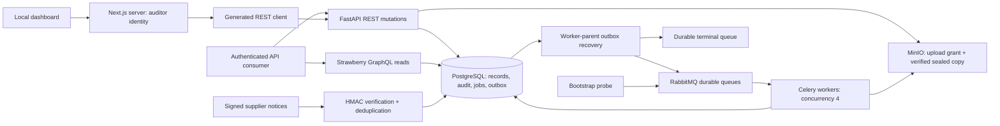

# Milestone 04 architecture

The diagram shows implemented paths. REST owns writes and GraphQL owns dashboard reads. Both derive organization/actor/role from a server-side credential digest lookup. HMAC supplier identities are separately configured and cannot supply their own tenant context. All collections use bounded, signed keyset pagination. The canonical OpenAPI and hand-authored GraphQL SDL are checked against actual served schemas; REST and GraphQL clients are generated from those contracts.

The dashboard remains a local read-only synthetic workspace. Its Next.js server calls `/v1/demo/snapshot` using the generated REST client and an auditor key. `API_BASE_URL` and `RECONCILE_WEB_API_TOKEN` remain on the server; browser components receive synthetic records, never credentials. The local dashboard has no end-user login. Errors render a retryable unavailable screen without falling back to fixtures. Generated GraphQL documents and a typed transport are available for consumers; they are not yet the dashboard's data source.

Migrations `0003_financial`, `0004_vendor_ref` and `0005_evidence_seals` extend the preserved foundation and contract tables with normalized financial lines, versioned extraction evidence, users/memberships, vendors, tolerance policies and recovery records. Tenant-composite foreign keys bind parent, organization, currency and vendor relationships. Existing rows and audit history survive backfill; missing legacy financial evidence is never invented. Exact arithmetic constraints and immutable evidence support later processing. The optional vendor integration reference demonstrates an expand step with rollback allowed only while unused. See the [database ER diagram and accounting rules](database.md) and [migration operations](../operations/database.md).

Every bearer mutation claims an organization-wide idempotency key transactionally before its business effects. The fingerprint binds actor, route and normalized validated body. Matching retries return the committed response; altered requests conflict. Existing record mutations check an expected version and lock the row in PostgreSQL. Upload completion verifies bounded size, MIME, signature and hash, then seals a separate object key so the original presigned URL cannot mutate worker input.

New jobs, outbox envelopes and admission audits commit together. A worker-parent recovery loop claims pending envelopes with leases, publishes persistent messages with RabbitMQ confirms and recovers expired/unconsumed work. Four prefork processes with prefetch one verify tenant-owned MinIO inputs, parse bounded digital PDFs and atomically commit sealed untrusted text, an execution key and final state. At most five attempts are allowed; terminal records are immutable and a separate confirmed outbox publication reaches the durable dead-letter queue. Admin replay retains the original execution and history. No OCR, AI provider or full matching is claimed. See the [processing lifecycle and runbook](../operations/processing.md).

Authoritative financial arithmetic lives in the pure reconciliation package: bounded integer minor units, explicit currencies, Decimal quantities and half-up line rounding, deterministic header consistency. Metrics group currencies separately. PO tax amounts are validated for consistency; jurisdictional tax and full matching policies remain later work. API review acceptance records a human decision and never authorizes payment. AI output remains untrusted; the offline fixture evaluation makes no model-quality claim.

Lite mode migrates SQLite and verifies authenticated ASGI reads without requiring broker/object-store health. Full Compose uses PostgreSQL, RabbitMQ and MinIO and exposes only loopback ports. See [contracts](../../packages/contracts/README.md) for role permissions, cursor guarantees, error types, HMAC signing and retry semantics, and [verification](../verification/milestone-02.md) for measured evidence. Normalized financial models, seed PDFs and digital-text processing are implemented. Financial field extraction, OCR/AI, full matching, production identity and deployment follow later milestones in `CODEX.md`. Current evidence is in [milestone 04 verification](../verification/milestone-04.md).
