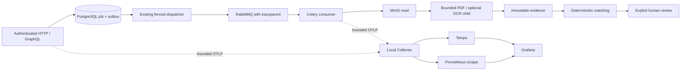

# Local observability

Milestone 08 implementation is in progress. See [verification](../verification/milestone-08.md) for actual checks and outstanding Docker-dependent proof. This stack supports local synthetic workloads. It does not establish production readiness.

## Architecture



The API stores validated W3C `traceparent` in new outbox payloads and a trace ID in the authorized job record. The dispatcher restores the durable context and puts its publishing context in AMQP headers. Official Celery instrumentation extracts the message context. The business processing span uses that consumer context, with the durable outbox as fallback. Retried attempts start a new trace linked to the original context. Database, storage, parser timings, evidence, matching and review are instrumented at service boundaries. The pure monetary/matching package has no telemetry dependency.

Clients that reuse one W3C context across reservation, upload and completion can correlate all three HTTP operations. Independent client requests have independent traces; the job follows upload completion. Existing envelopes without context start valid new traces. Restoring a missing legacy outbox cannot reconstruct a missing span ID; no parent relationship is fabricated. Span links and complete exported broker ancestry still require final real-service verification.

The parser child has a clean environment and no exporter. It returns bounded numeric wall/CPU/RSS timings separately from document evidence. Its parent emits timed child spans. This preserves Linux network denial and the documented incomplete filesystem/process sandbox.

## Start and stop

```sh
python3 scripts/setup_env.py
make benchmark-init
make observability-up
# Preserve all volumes on shutdown:
make observability-down
```

The runner uses only `compose.benchmark.yml:compose.observability.yml`, project `reconcileiq-m08`, and private `.cache/m08/.env` credentials. Existing files and secrets are preserved. It never changes the retained development project's database or volumes. Docker must be available; do not reset volumes to recover health.

| Service    | Loopback address         | Access                                    |
| ---------- | ------------------------ | ----------------------------------------- |
| API        | `http://127.0.0.1:28000` | Existing role credentials                 |
| Web        | `http://127.0.0.1:23100` | Existing encrypted local role sessions    |
| OTLP HTTP  | `http://127.0.0.1:14318` | Trusted local senders only                |
| Prometheus | `http://127.0.0.1:19090` | Trusted local machine                     |
| Tempo      | `http://127.0.0.1:13200` | Trusted local machine                     |
| Grafana    | `http://127.0.0.1:13000` | `local-admin`, private generated password |

PostgreSQL is on 25432, RabbitMQ on 25672/25673, MinIO on 29100/29101. Monitoring ports bind only loopback. Services share an internal telemetry network and the local project bridge: Docker Desktop did not publish ports for containers attached only to the internal network. This configuration is not a hard outbound network firewall. Export destinations are fixed to local services; Grafana reporting/update checks and Tempo usage reporting are disabled. Do not expose these unauthenticated local APIs publicly.

## Configuration and bounds

`RECONCILE_TELEMETRY_ENABLED` defaults false. Backend process environment variables configure the SDK; it does not independently load `.env`. Compose's optional overlay sets enabled from `RECONCILE_OBSERVABILITY_ACTIVE`, endpoint `http://otel-collector:4318`, and environment `local` or `benchmark`. Version defaults `0.1.0-m08`; sample ratio defaults 1. Endpoint validation accepts only HTTP on reviewed local hosts, with no URL credentials/query/path. No cloud exporter or paid fallback exists. Invalid initialization falls back to disabled telemetry with a fixed diagnostic.

Official OTel API/SDK/OTLP HTTP are locked to 1.45.1. Official FastAPI/Celery contrib instrumentations use their corresponding 0.66b1 release family; their beta versioning is explicit and covered by compatibility/privacy tests. SQLAlchemy uses public per-engine hooks so SQL text, parameters and connection URLs never enter SDK storage. Automatic high-cardinality metrics are replaced with bounded application instruments. Strawberry uses its supported schema extension interface.

Application trace queues hold at most 512 spans, batches at most 64, with 500 ms scheduling and a one-second HTTP export deadline. Sampling, 16 span attributes, zero events, eight links and 128-character attribute bounds limit storage. Export requests ignore proxy and global auth-header environment settings. Metric export runs every five seconds on background threads. Prefork children initialize fresh readers; graceful worker exit flushes once. Forced termination may lose buffered telemetry, never durable business jobs.

Collector memory limiting is 192 MiB plus a 32 MiB spike allowance, batches 128/256, export queue 256 with two consumers and a ten-second retry horizon. Prometheus retains two hours/128 MB; Tempo retains one hour with local storage. Container memory ceilings: Collector 256 MiB, Prometheus 256 MiB, Grafana 384 MiB, Tempo 512 MiB. Each is capped at 0.75 CPU. Pinned digests and non-root healthcheck wrappers are repository-managed. Tempo 3 uses the single-binary local backend configuration; no Kafka service is added.

Queues are intentionally lossy during long monitoring outages. Metrics and traces are operational aids, not financial/audit authorities. Gauge observations may lag five-second export/scrape intervals and remain stale for up to two minutes. Restarted service instances carry random non-customer instance IDs; aggregate snapshot gauges using `max`, not a sum of stale instances. Counter increments are best effort after commit, not exactly-once audit delivery across a process crash.

## Metrics catalog

Prometheus normalizes dots to underscores; duration units become `_seconds`, counters gain `_total`. Count gauges use no dimensionless ratio unit.

| Metric family                                                                                                     | Unit and meaning                                                                                                   |
| ----------------------------------------------------------------------------------------------------------------- | ------------------------------------------------------------------------------------------------------------------ |
| `riq_http_requests_total`, `riq_http_rejections_total`                                                            | HTTP responses, including 401/403/429; registered route templates/method/status only                               |
| `riq_http_duration_seconds`, `riq_graphql_errors_total`                                                           | Response histogram; GraphQL validation/resolver error count without queries                                        |
| `riq_db_duration_seconds`                                                                                         | SQL operation duration, operation keyword/system only                                                              |
| `riq_jobs`, `riq_outbox_pending`, `riq_jobs_retry_exhausted`                                                      | Current durable state counts and terminal exhaustion                                                               |
| `riq_jobs_oldest_pending_age_seconds`, `riq_queue_wait_seconds`                                                   | Oldest pending age; first-running commit time minus admission                                                      |
| `riq_jobs_transitions_total`, `riq_jobs_completed_total`, `riq_jobs_retries_total`                                | Final job state observed per committed transaction; terminal outcome and scheduled retries                         |
| `riq_jobs_total_duration_seconds`                                                                                 | Admission-to-terminal database timestamp histogram, including retries                                              |
| `riq_worker_starts_total`, `riq_worker_heartbeat_total`, `riq_lease_recoveries_total`                             | Worker starts, dispatcher heartbeat, scoped lease recovery activity                                                |
| `riq_broker_ready_messages`                                                                                       | Passive broker ready depth by finite business/terminal destination                                                 |
| `riq_dependency_available`, `riq_dependency_failures_total`, `riq_dependency_checks_total`                        | Local database/broker/storage health and failures                                                                  |
| `riq_document_pages_total`, `riq_document_unsupported_total`, `riq_document_checksum_failures_total`              | Parsed pages and committed job diagnostic classifications                                                          |
| `riq_pdf_duration_seconds`, `riq_ocr_duration_seconds`                                                            | Real child-reported digital/OCR durations                                                                          |
| `riq_parser_cpu_milliseconds`, `riq_parser_peak_rss_bytes`                                                        | Real child self/child CPU and peak RSS histograms                                                                  |
| `riq_stage_duration_seconds`, `riq_stage_calls_total`                                                             | Fixed service stages, finite outcome labels                                                                        |
| `riq_reconciliation_results`, `riq_reconciliation_discrepancies`, `riq_review_backlog`, `riq_validation_failures` | Durable results/category counts, review backlog and retained total-inconsistency discrepancies                     |
| `riq_provider_status`                                                                                             | Disabled/configured-unavailable status; configuration is not verified cloud availability                           |
| `riq_provider_requests_total`, `riq_provider_duration_seconds`                                                    | Actual abstraction invocations by explicitly synthetic/live-free mode                                              |
| `riq_provider_input_tokens_total`, `riq_provider_output_tokens_total`                                             | Recorded known usage only; no invented unknown token totals                                                        |
| `riq_provider_quota_total`, `riq_provider_timeouts_total`                                                         | Observed bounded provider failures                                                                                 |
| `riq_provider_estimated_cost_USD_total`                                                                           | Zero for injected offline providers under the documented zero-cloud-call assumption; no live pricing/cost measured |

Counters are sparse until their first real observation. Empty Grafana panels mean no observations, not measured zero or a simulated healthy provider. Five provisioned dashboards cover System Overview, Invoice Processing, Reconciliation, AI Operations and Reliability. PromQL p50/p95/p99 can use `histogram_quantile` over duration buckets; sample counts and buckets constrain accuracy. Use raw benchmark observations for the reported short-run percentiles.

## Privacy and validation

The tracer wrapper allowlists span names, scope attributes and finite attribute values before SDK storage. It drops events, exception messages/stack traces, status descriptions, baggage, tracestate, raw HTTP/GraphQL/SQL payloads, object URLs and identifiers. Only random W3C IDs are propagated. OTel exporter/SDK exception logging is suppressed; no raw exception is printed by the application wrapper. No header capture or automatic resource detector is enabled.

```sh
uv run --all-packages pytest tests/test_telemetry.py
uv run --all-packages python scripts/benchmark_env.py compose exec -T otel-collector /otelcol-contrib validate --config=/etc/otelcol/config.yaml
uv run --all-packages python scripts/benchmark_env.py compose exec -T prometheus /bin/promtool check config /etc/prometheus/prometheus.yaml
# After synthetic provider and fault probes, verify actual exported parent IDs/links:
make observability-check
```

The smoke verifies provisioned dashboards, actual metric queries, publisher-to-consumer ancestry, retry links and exported privacy. Passing unit spans alone is insufficient. Keep generated evidence private in `.cache/m08/results`; publish only reviewed aggregates.
