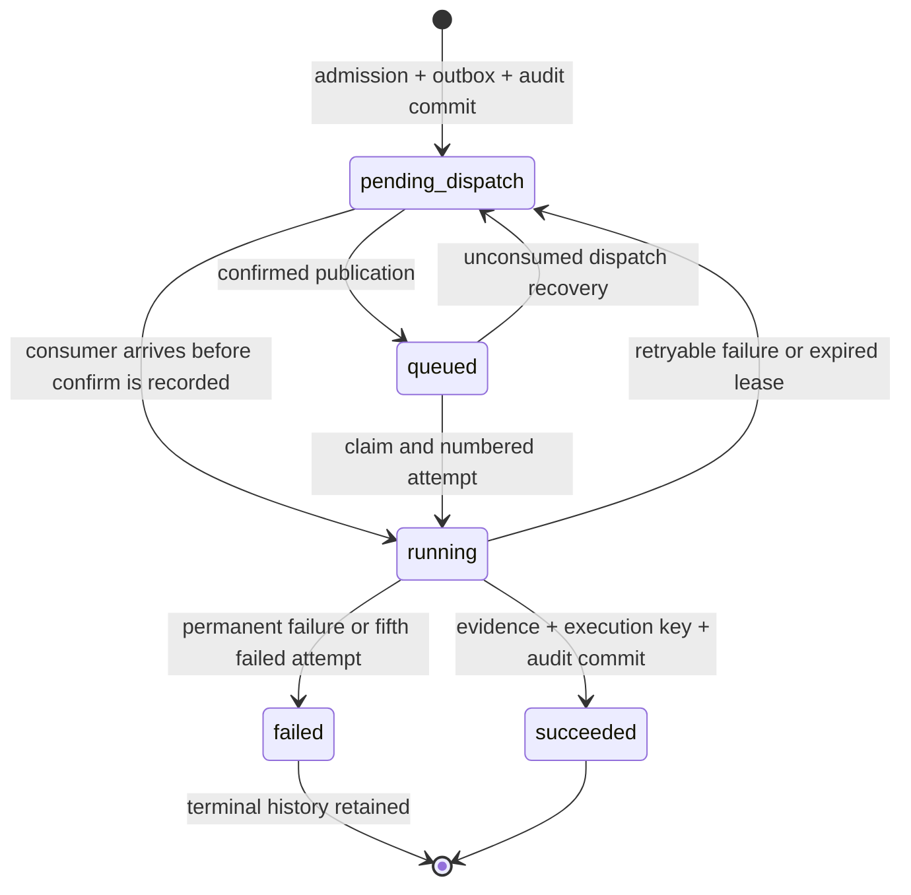

# Reliable local invoice processing

Milestone 04 runs digital-PDF text extraction through the existing Celery worker, RabbitMQ, MinIO and PostgreSQL. It does not use OCR, Gemini or another paid provider. Successful text capture produces sealed **untrusted** evidence, not validated financial fields, a match or an approval.

## Start and inspect

```sh
make bootstrap
docker compose ps
docker compose exec -T worker python -m reconcileiq_worker.status
docker compose exec -T rabbitmq rabbitmqctl list_queues name messages_ready messages_unacknowledged consumers
docker compose logs --tail 50 worker
# Host verification against the running full stack; appends synthetic records:
uv run --all-packages python scripts/contracts_smoke.py
PLAYWRIGHT_CHANNEL=chrome pnpm test:e2e
```

Bootstrap preserves volumes, migrates to `0006_processing_stage`, seeds idempotently and starts all six existing services. No extra dispatcher service is required: a supervised worker bootstep runs the recovery publisher in the worker parent process. Multiple instances arbitrate claims through PostgreSQL row locks, leases and `SKIP LOCKED`. The worker declares the durable terminal queue at startup, including on an empty installation.

`make bootstrap-lite` remains a SQLite/API/frontend smoke. It does not run business workers. `make worker` explicitly enables processing and requires a matching PostgreSQL URL and RabbitMQ broker in your secure host environment. A worker configured with SQLite and a shared RabbitMQ is rejected, preventing it from acknowledging messages belonging to another database. Prefer Compose for the complete local workflow. Do not print connection URLs or source a dotenv file as shell code.

Configuration uses `RECONCILE_` environment settings; Compose forwards these optional controls. Existing `.env` credentials are preserved. The template contains placeholders, never real keys.

| Setting suffix                | Default | Meaning                                               |
| ----------------------------- | ------: | ----------------------------------------------------- |
| `WORKER_CONCURRENCY`          |       4 | Bounded prefork processes, configurable 1–16          |
| `WORKER_LEASE_SECONDS`        |     120 | Processing ownership window; minimum 90 seconds       |
| `DISPATCH_INTERVAL_SECONDS`   |       2 | Recovery/publisher polling interval                   |
| `DISPATCH_BATCH_SIZE`         |      25 | Maximum claims per sweep                              |
| `DISPATCH_VISIBILITY_SECONDS` |     180 | Recover a confirmed queued job that was never claimed |
| `ADMITTED_JOB_LIMIT`          |     500 | Active jobs per organization; configurable downward   |
| `RETRY_BASE_SECONDS`          |       5 | Exponential retry base                                |
| `RETRY_MAX_SECONDS`           |     300 | Exponential jitter ceiling                            |

Prefetch is one per worker process. Tasks have a 40-second soft deadline and 60-second hard deadline; the lease exceeds both. Worker children recycle after 50 tasks or a 256,000 KiB RSS threshold measured after a task. These limits are not a complete malicious-PDF sandbox. Compose allows 90 seconds for graceful shutdown. Worker transactions have a five-second statement timeout and two-second lock timeout; storage and publishing happen outside database locks.

## Lifecycle and evidence



An admitted response remains the original 202/idempotency response even if processing finishes before the client polls. `GET /v1/jobs/{id}` gives the current state. Additive `GET /v1/processing-jobs` provides tenant-scoped cursor pagination, stage, next-attempt time, active count and configured capacity. Existing job state enums and mutation inputs remain compatible. The existing Invoices page polls through the Next.js server-held auditor identity; credentials never enter browser bundles. “Retrying” is a presentation of a pending/queued job whose persisted stage is `retrying`, rather than a new API state.

The worker uses only organization and job IDs from the broker. It reloads ownership, invoice metadata and object references from PostgreSQL, ignoring object paths in the outbox payload. Only the invoice's own `<organization>/sealed/<uuid>.pdf` reference is accepted. It checks the object exists, declared PDF MIME, bounded size, signature and SHA-256 before parsing. It never follows document URLs or instructions.

Digital PDFs are limited to 10 MiB, 20 pages, 50,000 text characters per page and 200,000 total characters. Parser stream/decompression work is also bounded; external JBIG2 execution is disabled. Encrypted, corrupted, empty-text/scanned and unsupported inputs fail explicitly. `ObjectReader` and `TextProvider` interfaces allow later OCR/provider implementations without replacing dispatch, leases or persistence.

Text and page provenance are stored in an immutable `extraction_versions` row with `validation_state=untrusted`, `extracted_fields` and a retained extraction seal. The invoice becomes `extracted`; monetary fields stay unknown. A tenant-scoped execution key binds invoice, document digest and extractor revision. The evidence, seal, execution key, attempt outcome, job state and audit events commit together. Duplicate messages and manual replay cannot create a second effect for that key. An expired worker cannot commit after ownership changes. Existing financial fixtures, calculations, supplier-number constraints and audit history are retained.

Reconciliation and supplier-notice processing remain outside this digital-text milestone. Their admitted jobs reach an explicit `PROCESSOR_NOT_IMPLEMENTED` failure, retaining the original notice/run, rather than reporting invented results or fetching arbitrary references. A supplier PDF must enter through the authenticated upload workflow. Original header-only upload probes correctly fail real parsing with `INVALID_PDF`.

## Publication, retries and dead letters

Durable direct exchange `reconcileiq.tasks` routes `invoice` to `reconcileiq.invoices` and `probe` to `reconcileiq.probes`. Messages are JSON and persistent; publication uses RabbitMQ confirms. The work queues have a 10,000-message limit with `reject-publish`, so saturation preserves the pending database envelope instead of silently dropping work. Their dead-letter exchange is `reconcileiq.dead`, routing key `terminal`, with durable queue `reconcileiq.dead`. The worker does not consume that terminal queue.

Publication has a durable lease and separate attempt counter. Interrupted/uncertain confirms can publish twice; database effect keys prevent duplicate results. Confirmation is recorded only if the publisher still owns the claim. Actual completed delivery also settles the envelope, covering a lost confirm after the business transaction committed. Expired dispatch claims are recoverable. Confirmed queued jobs without a claim are republished after the visibility interval.

There are at most **five processing attempts per execution**, including the first. Retry delay uses equal jitter over the upper half of `min(maximum, base × 2^(attempt−1))`. A supported provider `Retry-After` seconds value or HTTP date is a lower bound, even above the normal jitter ceiling. Hints beyond 24 hours produce `RETRY_AFTER_OUTSIDE_WINDOW` instead of retrying early or reserving capacity indefinitely. Malformed hints are ignored. Missing objects and transient storage/network interruptions retry; malformed PDFs, wrong checksums, unsafe references, encryption and required OCR do not. Raw provider/driver exception text is never persisted.

A running attempt whose lease expires is finalized as failed with `WORKER_LEASE_EXPIRED`. Recovery schedules another bounded attempt or records terminal failure. Celery late acknowledgments, lost-worker rejection/requeue and cancellation on broker connection loss complement database recovery; neither task IDs nor broker redelivery alone prove idempotency.

Terminal failure commits `failed_jobs`, numbered attempt history, redacted error code, retryability, next action, trace identifier and audit events while retaining the invoice reference. The same durable outbox then publishes a compact terminal event explicitly into the dead-letter queue. A failed task's business outcome is therefore not dependent on Celery automatically dead-lettering an exhausted retry. Terminal publication retries independently if the broker is down. Redelivery can create duplicate notifications; the retained job ID identifies the same terminal failure.

## Recovery and replay

During a broker outage, admissions continue until the tenant limit. The API returns 429 and `Retry-After: 30` at capacity, without committing the rejected idempotency claim or partial business effects. Processing/list APIs use PostgreSQL and remain responsive while workers are busy; readiness accurately reports unavailable dependencies. Restoring RabbitMQ lets the publisher recover pending claims. Do not clear the queue, outbox or execution keys as a recovery procedure.

After an unexpected worker exit, restart only that service after infrastructure is healthy:

```sh
docker compose up -d --no-deps --no-build worker
docker compose exec -T worker python -m reconcileiq_worker.status
```

This avoids re-running dependency startup during a fault recovery. Wait for lease/visibility expiry where appropriate; repeated restarts do not bypass the processing attempt limit. Do not lower the lease below task deadlines. Queue depth output reports ready messages; use RabbitMQ's management UI/queue command above for unacknowledged messages and consumers as well.

Replay requires an admin, a retained retryable failed job, its current version, an explicit reason and a new logical idempotency key:

```http
POST /v1/jobs/{failed_job_id}/replay
Authorization: Bearer <admin credential>
Idempotency-Key: <unique replay key>
Content-Type: application/json

{"expected_version": 7, "reason": "Storage has been repaired and the original input is available."}
```

Read the actual version first. Identical HTTP retries return the original new job; changing the request conflicts. One replay child per execution is allowed. The failed original, immutable failure record, attempts and terminal notification remain retained; the child has its own bounded attempts and an audited `replay_of` link. Do not bulk-requeue terminal messages to retry business work. The local dashboard uses an auditor identity and therefore displays guidance without an unauthorized replay button. No review or replay authorizes a payment.

## Verification and limits

```sh
RECONCILE_TEST_POSTGRES=1 make check
make reliability-check
# Authorized, controlled local fault injection; temporarily pauses only this stack's
# broker, kills/restarts its worker, and appends new synthetic probe records:
uv run --all-packages python scripts/processing_smoke.py
uv run --all-packages python scripts/reliability_smoke.py
```

The fault script never resets the database or deletes documents. It verifies broker recovery, worker termination/restart with pending work, five missing-object attempts, retained terminal publication, denied auditor replay, idempotent admin replay and unchanged financial fixtures. A failed run may leave labelled probe records for diagnosis; restore controlled service interruptions before investigating. Run against local development only. The pre-activation backup was actually restored into a separate temporary database and checked before activation; see [recorded results](../verification/milestone-04.md).

Run shared-service fault scripts and browser processing tests sequentially. `reliability_smoke.py` pauses only this stack's MinIO/worker, verifies a persisted storage retry, restores both and measures 12 synthetic digital PDFs. It appends labelled probe records and never deletes retained documents. `make reliability-check` uses temporary SQLite files, private PostgreSQL schemas, newly created migration databases, private RabbitMQ queues and a uniquely created MinIO bucket. Cleanup removes only resources created by that test. Its Linux prefork test uses the local worker image plus read-only test/source mounts, test-only 1/3-second deadlines and accelerated lease expiry; the application worker keeps its 40/60-second deadlines and 120-second lease. Statement targets are 100% for accounting and at least 90% for processing, providers, dispatch and financial persistence; branch coverage and remaining gaps are reported separately. See [milestone 05 evidence](../verification/milestone-05.md).

Milestone 03's diagnostic exposure informed the worker's logging filters: configured secrets, credential-bearing connection strings and database/broker passwords are redacted, raw exception chains are removed, and PDF parser warnings are suppressed. Task messages contain IDs, not documents or presigned URLs. Keep environment files and local backups private. This is defense against accidental diagnostics, not a substitute for production identity, broker ACL design, PDF sandboxing, patching or credential lifecycle controls.

Remaining work includes OCR/AI/financial field extraction, full matching, production identity, stronger tenant scheduling fairness, load/soak tests, distributed tracing and a reviewed retention policy for objects and terminal notifications. No production throughput, security certification, OCR quality or AI quality is claimed. Milestone 05 is not started automatically.
